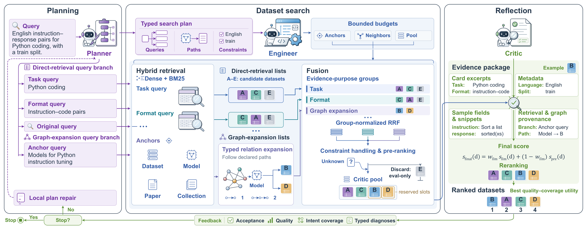

# From Intent to Improvement: Agentic Dataset Search for Better Model Training



This repository provides the implementation of **AgenticDS** and the **HuDS-Bench** dataset search benchmark for the paper **From Intent to Improvement: Agentic Dataset Search for Better Model Training**.

[Repository](https://github.com/nju-websoft/AgenticDS) | [HuDS-Bench](HuDS-Bench/) | [Usage](#usage)

## Introduction

Finding training data requires more than matching a dataset card to a few keywords. A data need may combine a task, supervision format, language, license, and training stage, while the evidence needed to verify these requirements can be spread across dataset cards, model training provenance, papers, and collections.

**AgenticDS** is a contract-governed multi-agent framework for natural-language dataset acquisition on Hugging Face. It separates intent interpretation, bounded retrieval execution, and evidence-grounded verification, and evaluates acquisition quality both by retrieval relevance and by the downstream models trained on the retrieved data.

The work makes three contributions:

- **Contract-governed dataset search:** typed plans, execution protocols, evidence records, and diagnoses connect language-model reasoning to predefined retrieval operations.
- **Provenance-aware verification:** textual, metadata, sample, and graph evidence remain separately inspectable when candidates are fused and reranked.
- **Retrieval-to-training evaluation:** HuDS-Bench measures dataset search quality, while a controlled search-to-train study measures the utility of the acquired datasets.

## Framework

AgenticDS follows three principles: **contracts before actions**, **provenance before fusion**, and **bounded autonomy**.

| Agent | Role |
|---|---|
| **Planner** | Compiles the request into complementary search branches, entity anchors, declared relation paths, hard constraints, soft preferences, and acceptance targets. |
| **Engineer** | Allocates bounded retrieval effort and compiles the plan into predefined operations for hybrid retrieval, graph expansion, fusion, and pre-ranking. |
| **Critic** | Reviews candidate evidence, reranks datasets, and returns typed diagnoses that guide local plan repair. |

```text
Natural-language query
  -> Planner: typed search plan
  -> Engineer: bounded execution protocol
  -> Hybrid retrieval + typed graph expansion
  -> Evidence archive + group-normalized rank fusion
  -> Constraint handling + candidate shortlist
  -> Critic: evidence-grounded ranking and diagnosis
  -> Ranked datasets or local plan repair
```

The Engineer's protocol is executed by deterministic code in `agent/executor.py`. Dense retrieval combines separate description and metadata embeddings, and Lucene BM25 supplies lexical evidence. Declared one- or two-hop paths through dataset, model, paper, and collection entities recover candidates that may be difficult to find from their own descriptions.

Each candidate retains its retrieval and graph provenance. The Critic reviews card excerpts, structured metadata, available sample snippets, and relation paths rather than relying on a similarity score alone. Missing metadata and unobserved graph links remain unknown evidence. Feedback can trigger local repairs within a bounded search loop; the default round cap is three.

## Data

### HuDS-Bench

[HuDS-Bench](HuDS-Bench/) contains **200 English queries** and **24,908 graded query-dataset judgments**, pooled over 15 retrieval systems. Candidate pools combine the systems' Top-20 results and include construction targets not retrieved by any system.

| Query type | Queries | Data need |
|---|---:|---|
| General | 90 | Task, language, modality, scale, or other dataset requirements |
| Fine-tuning | 40 | Instruction, dialogue, preference, or domain-adaptation data |
| Paper reference | 40 | Datasets associated with a paper or training lineage |
| Entity neighbor | 30 | Related datasets reached through typed entity relations |
| **Total** | **200** | |

The benchmark files use the following formats:

| File | Format | Fields |
|---|---|---|
| [queries.json](HuDS-Bench/queries.json) | JSON object containing a `queries` array | `query_id`, `query`, `query_type` |
| [qrels.jsonl](HuDS-Bench/qrels.jsonl) | One judgment per line | `query_id`, `candidate_id`, `relevance` |

An example query entry is:

```json
{
  "query_id": "q_001",
  "query": "large-scale annotated 3D object dataset for 3D vision and rendering",
  "query_type": "general"
}
```

An example judgment is:

```json
{"query_id": "q_001", "candidate_id": "3DAIGC/gobjaverse", "relevance": 1}
```

`candidate_id` is the complete Hugging Face dataset identifier, including its owner. The top-level `relevance` is an integer in `{0, 1, 2}`, representing non-relevance under the evaluation protocol, partial relevance, and strong relevance, respectively.

| Relevance | Judgments |
|---|---:|
| 0 | 12,625 |
| 1 | 9,763 |
| 2 | 2,520 |
| **Total** | **24,908** |

For example, load the benchmark with Python:

```python
import json

with open("HuDS-Bench/queries.json", encoding="utf-8") as f:
    queries = json.load(f)["queries"]

with open("HuDS-Bench/qrels.jsonl", encoding="utf-8") as f:
    qrels = [json.loads(line) for line in f if line.strip()]

relevance = {}
for row in qrels:
    relevance.setdefault(row["query_id"], {})[row["candidate_id"]] = row["relevance"]
```

### Retrieval Corpus

The experiments use a March 12, 2026 snapshot of HuggingKG as auxiliary infrastructure. Its heterogeneous relations connect datasets with models, papers, collections, and other Hugging Face resources.

Place the snapshot under the directory specified by `AGENTICDS_KG_DIR`. Index construction reads `datasets.json`, `models.json`, `papers.json`, and `collections.json`; relation expansion uses the edge files declared in `utils/kg_find_neighbors.py`. Entity normalization is defined in `utils/kg_index_store.py`. Use the same snapshot and embedding model for index building, service startup, and querying.

## Experiments

### Dataset Retrieval

The main AgenticDS configuration uses **GLM-5.2**, **Qwen3-Embedding-0.6B**, and at most **three search rounds**, returning up to **20 datasets**. The bge-m3 variant changes the embedding model. Claude Code and Codex use the same GLM-5.2 backbone and shared Hugging Face search and inspection tools; their outputs are filtered once against the evaluation snapshot.

The following results are reported in Table 2 of the paper. Bold marks the best value in each column. OOD rerankers are applied zero-shot without in-domain training.

| Method | NDCG@5 | NDCG@10 | NDCG@20 | MAP@5 | MAP@10 | MAP@20 |
|---|---:|---:|---:|---:|---:|---:|
| Google Dataset Search | 0.0301 | 0.0217 | 0.0165 | 0.0262 | 0.0146 | 0.0091 |
| Hugging Face Full-Text Search | 0.2786 | 0.2438 | 0.2100 | 0.2989 | 0.2301 | 0.1661 |
| BM25 | 0.4719 | 0.4717 | 0.4797 | 0.5912 | 0.5575 | 0.5252 |
| BM25 + RM3 | 0.4772 | 0.4703 | 0.4732 | 0.5994 | 0.5482 | 0.5047 |
| bge-m3 | 0.3102 | 0.3204 | 0.3309 | 0.4751 | 0.4475 | 0.4084 |
| Qwen3-Embedding-0.6B | 0.4728 | 0.4699 | 0.4808 | 0.6129 | 0.5830 | 0.5570 |
| bge-m3 + BM25 | 0.4039 | 0.4036 | 0.3972 | 0.5507 | 0.5144 | 0.4659 |
| MDRBM25 | 0.4602 | 0.4578 | 0.4698 | 0.5804 | 0.5420 | 0.5107 |
| ANCE (OOD) + BM25 | 0.4617 | 0.4570 | 0.4644 | 0.5913 | 0.5469 | 0.5069 |
| Qwen3-Embedding-0.6B + BM25 | 0.4911 | 0.4893 | 0.4964 | 0.6202 | 0.5919 | 0.5663 |
| monoT5 (OOD) + BM25 | 0.4976 | 0.4923 | 0.5006 | 0.6140 | 0.5795 | 0.5525 |
| Claude Code | 0.5328 | 0.5170 | 0.5169 | 0.7009 | 0.6700 | 0.6381 |
| Codex | 0.5370 | 0.5140 | 0.5082 | 0.7094 | 0.6764 | 0.6313 |
| AgenticDS (bge-m3) | 0.5692 | 0.5518 | 0.5424 | **0.7374** | 0.6871 | 0.6311 |
| AgenticDS (Qwen3-Embedding-0.6B) | **0.6297** | **0.6148** | **0.6114** | 0.7316 | **0.6973** | **0.6630** |

AgenticDS improves NDCG@10 by **25.7%** over Qwen3-Embedding-0.6B + BM25 and by **18.9%** over Claude Code. The paper also studies component ablations, per-query-type performance, and sensitivity to the agent backbone.

### Search-to-Train Utility

To test whether dataset search improves model training, each acquisition method contributes the eligible datasets among its **Top-5** results for one query in each domain. Each eligible dataset contributes at most **2,000 samples** under a shared preparation protocol. The study fine-tunes **Qwen2.5-7B**, **Llama-3.1-8B**, and **Olmo-3-7B-Instruct** using three epochs and learning rates in `{1e-5, 5e-6, 1e-6}`.

| Domain | Benchmarks | Metric |
|---|---|---|
| Mathematics | GSM8K, MATH, AMC23, OCWCourses | Exact match |
| Code | HumanEval, BigCodeBench | pass@1 |
| Medicine | MedQA, MMLU-Medical | Accuracy |

The following results are reported in Table 3 of the paper. Scores are on a 0-100 scale. Each domain score averages its benchmarks and the three base models; **Overall** is the equal-weight mean of the three domain scores.

| Acquisition method | Mathematics | Code | Medicine | Overall |
|---|---:|---:|---:|---:|
| No fine-tuning | 35.34 | 42.06 | 53.12 | 43.51 |
| Qwen3-Embedding-0.6B + BM25 | 45.96 | 49.21 | 54.09 | 49.75 |
| monoT5 (OOD) + BM25 | 41.13 | 44.85 | 58.12 | 48.03 |
| Claude Code | 42.37 | 47.00 | 58.51 | 49.29 |
| Codex | 41.09 | 46.17 | 57.65 | 48.30 |
| **AgenticDS** | **49.82** | **49.62** | **59.00** | **52.81** |

AgenticDS achieves the highest three-model average in each domain, linking acquisition quality to downstream training utility.

## Usage

### 1. Set Up the Environment

Clone the repository:

```bash
git clone https://github.com/nju-websoft/AgenticDS.git
cd AgenticDS
```

Run the following commands from the repository root. Use Linux, Python 3.10 or later, and Java 11 or later. A CUDA-capable GPU is recommended for the query encoder; FAISS indexes and Lucene retrieval use CPU memory.

```bash
uv venv --python 3.10 .venv
uv pip install --python .venv/bin/python -r requirements.txt
.venv/bin/python -m utils.lucene_runtime --install
```

### 2. Configure the LLM and Snapshot

```bash
cp .env.example .env
chmod 600 .env
```

Set the API endpoint and key, model identifiers, snapshot directory, and cache paths in `.env`. The example selects GLM-5.2, Qwen3-Embedding-0.6B, and `cuda:0`; replace the placeholder API endpoint and `KG/snapshot` with your configuration. Load the settings in each terminal:

```bash
set -a
. ./.env
set +a
```

The program reads environment variables and does not load `.env` automatically. Set `AGENTICDS_HF_LOCAL_FILES_ONLY=false` when downloading an uncached embedding model. Configuration options are defined in `global_values.py`.

### 3. Build the Indexes

Build each entity scope separately:

```bash
for entity in dataset paper collection model; do
  .venv/bin/python -m utils.kg_hybrid_index_builder \
    --embedding-model "$AGENTICDS_EMBEDDING_MODEL_NAME" \
    --kg-dir "$AGENTICDS_KG_DIR" \
    --index-cache-dir "$AGENTICDS_INDEX_CACHE_DIR" \
    --entity-types "$entity" \
    --progress-file "logs/index-$entity.progress.json"
done
```

The builder writes separate FAISS indexes for descriptions and metadata, aligned entity stores, and Lucene BM25 indexes. Dense indexes are embedding-specific. Lucene indexes can be shared when the snapshot, entity scope, and entity row order match.

### 4. Start the Retrieval Service

Start the service in a separate terminal with the same configuration:

```bash
.venv/bin/python -m services.retrieval_server \
  --snapshot "$AGENTICDS_KG_DIR" \
  --embedding-model "$AGENTICDS_EMBEDDING_MODEL_NAME" \
  --entity-types dataset,paper,collection,model \
  --cache-dir "$AGENTICDS_INDEX_CACHE_DIR" \
  --query-encoder-device "$AGENTICDS_LOCAL_EMBEDDING_DEVICE" \
  --socket runtime/agenticds-retrieval.sock \
  --progress-file logs/retrieval-service.progress.json
```

Wait until the progress file reports `status: ready`. The service keeps one snapshot/model index group resident so repeated agent runs reuse the indexes.

### 5. Search for Datasets

```bash
.venv/bin/python demo.py \
  --query "competitive programming instruction tuning dataset with problem statements test cases accepted code solutions and code generation supervision" \
  --top-k 20 \
  --max-iterations 3 \
  --agent-model "$AGENTICDS_LLM_MODEL_NAME" \
  --embedding-model "$AGENTICDS_EMBEDDING_MODEL_NAME" \
  --retrieval-service-socket runtime/agenticds-retrieval.sock
```

The CLI prints a Top-5 preview and saves the full requested ranking under `output/runs/demo_<timestamp>/`:

- `final.json`: query, ranked dataset identifiers, and final scores.
- `agent.json`: plans, execution evidence, feedback, round selection, and timings.

Use `--debug-full-trace` for detailed LLM traces and `--help` for all CLI options. Check fallback events when evaluating LLM behavior. Claude Code and Codex CLIs are installed separately when using their baseline adapters.

## Repository Structure

```text
HuDS-Bench/      Dataset search queries and graded relevance judgments
agent/           Planner, Engineer, Executor, Critic, contracts, and orchestration
prompt/          Agent and replanning prompts
llm/             OpenAI-compatible LLM gateway
utils/           Embeddings, indexing, graph traversal, and rank fusion
services/        Persistent retrieval service and client
_baseline/       Platform, sparse, dense, hybrid, reranking, and agent baselines
demo.py          Single-query entry point
global_values.py Environment-based configuration
requirements.txt Python dependencies
```

## Related Resources

AgenticDS uses HuggingKG as auxiliary relational infrastructure. See [HuggingBench](https://github.com/nju-websoft/HuggingBench) and its [HuggingKG documentation](https://github.com/nju-websoft/HuggingBench/tree/main/HuggingKG) for the original graph construction work and associated recommendation, classification, and tracing benchmarks. HuDS-Bench evaluates natural-language dataset search, while the search-to-train study measures the utility of the acquired data.

## License

Apache License 2.0. See [LICENSE](LICENSE). Third-party datasets, model weights, and graph source materials remain subject to their respective licenses.
